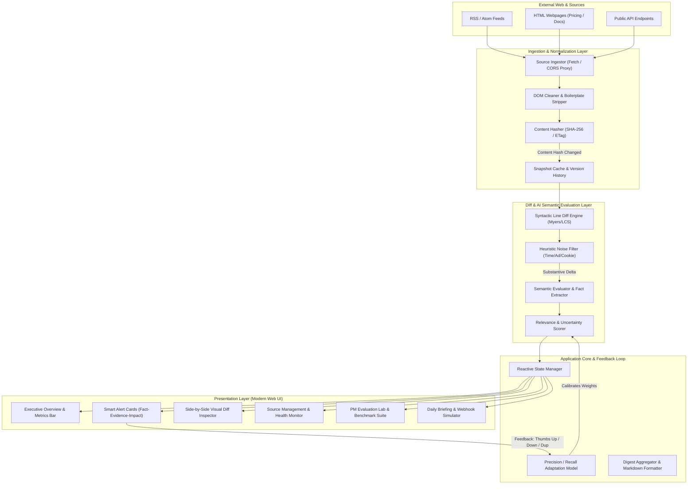
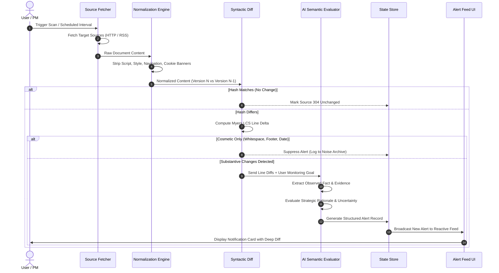
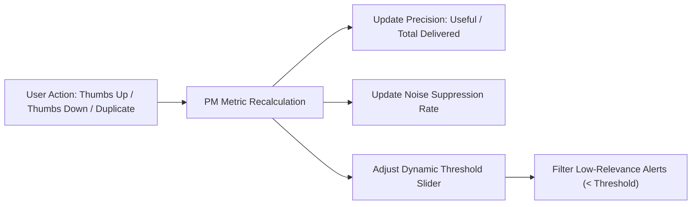

# System Architecture: AI Internet Monitor (SentinelAI)

> **Document Type:** Technical & System Architecture Specification  
> **Reference:** Derived from [context.md](file:///c:/MyDeveloper-Projects/Project%205%20%E2%80%94%20AI%20Internet%20Monitor/doc/context.md)  
> **Status:** Final Architectural Blueprint  
> **Version:** 1.0.0  

---

## 1. Architectural Principles & System Goals

The architecture of **SentinelAI** is designed around four core tenets:

1. **Deterministic Grounding Before AI Synthesis:**  
   AI models should never summarize ungrounded web text. The system enforces a hard architectural boundary: raw documents are stripped of noise and deterministically diffed first. Only the verified delta (with before/after line references) is passed to the semantic evaluation layer.
2. **Fact vs. Interpretation Separation:**  
   The data model strictly bifurcates an **Observed Fact** (verifiable, immutable delta) from an **AI Strategic Interpretation** (contextual inference calibrated with an uncertainty rating).
3. **Adaptive Noise Suppression:**  
   A multi-tier filtering pipeline (Syntactic -> Heuristic -> Semantic) ensures that low-entropy shifts (cookie banners, analytics code, footer copyright dates, re-flowed whitespace) are eliminated before alert creation.
4. **Zero-Friction Deployment & Zero-Server Portability:**  
   The application is architected as an ultra-responsive, standalone Progressive Web Application (PWA) deployable natively to **GitHub Pages**. It features client-side snapshot diffing, CORS-friendly live RSS fetching with robust synthetic fallbacks, and local storage persistence.

---

## 2. High-Level System Architecture



---

## 3. Data Flow & Processing Pipeline

The change-detection and alert generation lifecycle follows a structured 6-stage pipeline:



---

## 4. Ingestion & Content Normalization Details

### 4.1 Boilerplate & Noise Stripping
Web pages are contaminated with volatile artifacts. The Normalization Engine applies regex and DOM traversal to discard:
- `<script>`, `<style>`, `<noscript>`, `<iframe>`, and SVG markup.
- Common cookie consent containers (`#cookie-banner`, `.gdpr-notice`, `[aria-modal="true"]`).
- Dynamic timestamps and relative time tags (e.g., `"Updated 2 minutes ago"` or `"© 2026 Corporation"`).
- Ephemeral CSRF tokens, analytics tracking query parameters, and session identifiers.

### 4.2 Content Hashing
Cleaned text is hashed using a fast client-side checksum. If $H(T_n) == H(T_{n-1})$, execution halts immediately without invoking the semantic diff or AI evaluator, preserving computing resources.

---

## 5. Semantic Diff & AI Evaluation Engine

When a substantive change is identified, the delta is evaluated through the **Fact-Evidence-Interpretation** framework.

### 5.1 Evaluation Schema
```json
{
  "observedFact": "Stripe announced a 0.5% surcharge on cross-border transactions in APAC regions starting Nov 2026.",
  "evidenceSnippet": "- Cross-border rate: 1.0%\n+ Cross-border rate: 1.5% (effective Nov 1, 2026)",
  "strategicImpact": "Impacts gross margins for our international expansion in Singapore and Japan. Pricing team should evaluate passing surcharge to localized checkouts.",
  "relevanceScore": 0.94,
  "uncertainty": "LOW",
  "category": "PRICING_AND_TERMS"
}
```

### 5.2 Uncertainty Calibration Heuristic
- **LOW UNCERTAINTY:** The delta contains concrete numbers, dates, version tags, or direct policy statements (e.g., `"Prices increase from $20 to $30 on Dec 1"`).
- **MEDIUM UNCERTAINTY:** The delta describes qualitative capability updates without clear technical constraints (e.g., `"Enhanced enterprise security protocols"`).
- **HIGH UNCERTAINTY:** The delta contains ambiguous marketing phrasing or vision statements where business consequences cannot be definitively validated (e.g., `"Reimagining the future of collaborative intelligence"`).

---

## 6. Core Data Models

### 6.1 Source Model (`Source`)
```typescript
interface Source {
  id: string;
  name: string;
  url: string;
  category: 'COMPETITOR' | 'API_DOCS' | 'PRICING' | 'INDUSTRY' | 'CHANGELOG';
  monitoringGoal: string;      // e.g., "Detect pricing changes and breaking API deprecations"
  checkFrequencyMinutes: number;
  lastCheckedAt: string;
  lastChangedAt: string;
  healthStatus: 'HEALTHY' | 'DEGRADED' | 'CHECKING' | 'ERROR';
  historySnapshotsCount: number;
  icon: string;
}
```

### 6.2 Alert Model (`Alert`)
```typescript
interface Alert {
  id: string;
  sourceId: string;
  sourceName: string;
  timestamp: string;
  title: string;
  observedFact: string;        // Objective statement
  evidence: string;            // Exact line diff or citation
  strategicImpact: string;     // AI contextual interpretation
  relevanceScore: number;      // 0.00 to 1.00
  uncertainty: 'LOW' | 'MEDIUM' | 'HIGH';
  status: 'UNREAD' | 'READ' | 'ARCHIVED';
  userFeedback?: 'USEFUL' | 'IRRELEVANT' | 'DUPLICATE';
  diffId: string;
  sourceUrl: string;
  tags: string[];
}
```

### 6.3 Diff Snapshot Model (`DiffSnapshot`)
```typescript
interface DiffSnapshot {
  id: string;
  sourceId: string;
  timestamp: string;
  previousContent: string;
  currentContent: string;
  linesAdded: number;
  linesRemoved: number;
  suppressedNoiseLines: number;
  diffChunks: Array<{
    type: 'ADD' | 'REMOVE' | 'UNCHANGED' | 'NOISE_SUPPRESSED';
    text: string;
    lineNumberBefore?: number;
    lineNumberAfter?: number;
  }>;
}
```

---

## 7. Interactive Feedback & PM Adaptive Loop



User feedback is directly connected to the system's evaluation engine:
- Marking an alert as **"Irrelevant"** increments false-positive counters and dynamically suppresses similar pattern matches.
- Marking an alert as **"Duplicate"** triggers the clustering engine to collapse redundant cross-source announcements (e.g., both TechCrunch and a company blog reporting the same seed round).
- Marking an alert as **"Useful"** validates precision and promotes the source's weight in the Daily Digest.

---

## 8. Deployment & GitHub Pages Architecture

```
Project Root
├── index.html              # Modern, semantic single-page application entry point
├── manifest.json           # PWA metadata for installation & mobile readiness
├── css/
│   ├── main.css            # Design system, CSS variables, typography, animations
│   ├── components.css      # Card styles, modal, diff viewer, badges, toast
│   └── responsive.css      # Responsive media queries for mobile, tablet, desktop
├── js/
│   ├── app.js              # Core application entry, routing, and event delegation
│   ├── state.js            # Reactive state store with LocalStorage persistence
│   ├── sources.js          # Curated source catalogue and custom source manager
│   ├── diff-engine.js      # Line diff computation, normalizer, and noise filter
│   ├── evaluator.js        # AI significance analyzer and uncertainty classifier
│   ├── benchmark.js        # PM Evaluation Lab & 6-test ground truth benchmark
│   └── digest.js           # Daily Executive Briefing & Webhook exporter
├── assets/
│   ├── logo.svg            # Custom modern SentinelAI brand SVG logo
│   └── favicon.svg         # Crisp SVG vector favicon
└── doc/
    ├── context.md          # Product context specification
    ├── architecture.md     # Technical and system architecture specification
    └── implementation-plan.md # Phased engineering implementation roadmap
```

### Key Advantages for GitHub Pages:
- **Instant Live View:** Zero build step required, no `npm run build` breakage or stale node dependencies.
- **Pure Client Execution:** Fully operational offline or via browser fetch with automated graceful fallback to realistic historical simulation deltas.
- **Push & Deploy:** Standard `git push origin main` makes the application immediately accessible to recruiters, team members, and users worldwide.
